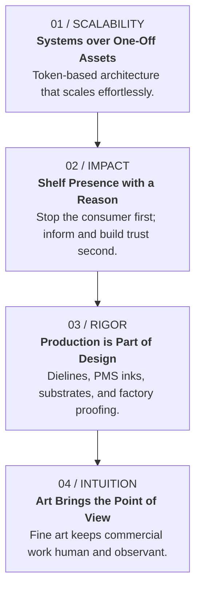
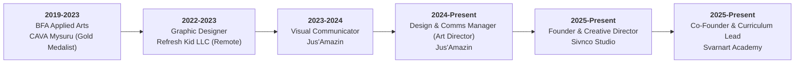
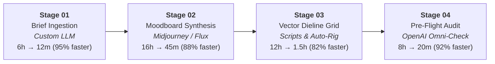

# SIVNCO STUDIO & H P SHIVARAJ (SHIV)
## Complete Archival Dossier: The Practitioner, The Work & The Digital Platform
*Generated on 2026-10-26 | Bengaluru, Karnataka, India*

---

## TABLE OF CONTENTS
1. [EXECUTIVE SUMMARY](#1-executive-summary)
2. [PART I: THE PRACTITIONER — H P SHIVARAJ](#2-part-i-the-practitioner--h-p-shivaraj)
   - [2.1 Biographical & Identity Overview](#21-biographical--identity-overview)
   - [2.2 Classical Pedigree & Fine Art Foundation](#22-classical-pedigree--fine-art-foundation)
   - [2.3 Core Creative Philosophy](#23-core-creative-philosophy)
   - [2.4 The Four Working Principles](#24-the-four-working-principles)
   - [2.5 Strategic Discipline of Rejection (The Anti-Brief)](#25-strategic-discipline-of-rejection-the-anti-brief)
   - [2.6 Chronological Career Trajectory](#26-chronological-career-trajectory)
   - [2.7 Verified Commercial Impact & Metrics](#27-verified-commercial-impact--metrics)
   - [2.8 Art Education & Mentorship Practice](#28-art-education--mentorship-practice)
   - [2.9 Leadership Testimonials & Industry Feedback](#29-leadership-testimonials--industry-feedback)
   - [2.10 Contact Coordinates & Verified Channels](#210-contact-coordinates--verified-channels)
3. [PART II: THE SITE — SIVNCO.IN ARCHITECTURE & ECOSYSTEM](#3-part-ii-the-site--sivncoin-architecture--ecosystem)
   - [3.1 Platform Vision & Aesthetic Architecture](#31-platform-vision--aesthetic-architecture)
   - [3.2 The Signature Design System & Token Hierarchy](#32-the-signature-design-system--token-hierarchy)
   - [3.3 Comprehensive Technology Stack](#33-comprehensive-technology-stack)
   - [3.4 Complete Page Directory & Route Architecture](#34-complete-page-directory--route-architecture)
   - [3.5 Flagship Case Study Deep Dives](#35-flagship-case-study-deep-dives)
   - [3.6 Interactive & Sensory Engineering Features](#36-interactive--sensory-engineering-features)
   - [3.7 In-House Ventures Ecosystem](#37-in-house-ventures-ecosystem)
   - [3.8 AI Acceleration & Production Pipeline](#38-ai-acceleration--production-pipeline)
   - [3.9 Deployment, Performance & Security Specifications](#39-deployment-performance--security-specifications)
4. [APPENDIX: QUICK REFERENCE SHEET](#4-appendix-quick-reference-sheet)

---

## 1. EXECUTIVE SUMMARY

**H P Shivaraj (Shiv)** is a Bengaluru-based **Art Director, Packaging Architect, Brand Lead, and Classical Fine Artist**. He graduated as a **BFA Gold Medalist and University Topper** in Applied Arts from the prestigious Chamarajendra Academy of Visual Arts (CAVA), University of Mysore. 

Combining classical fine-art rigor (observational anatomy, color chemistry, chiaroscuro, and printmaking) with high-velocity commercial D2C and FMCG packaging ownership, Shiv directs complete visual ecosystems from inception to industrial press runs exceeding 200,000+ units.

As the **Design & Communications Manager (Art Director)** at **Jus’Amazin Foods & Beverages**, Shiv took sole creative ownership over the entire brand and packaging overhaul of 15+ SKUs across jars, flow-wrap bars, stand-up pouches, sachets, and retail POS systems. This visual transformation directly contributed to a **176% verified FY24–25 revenue surge** alongside product, sales, and operations teams, while operating with **zero external agency dependency** and accelerating internal design turnaround by **40%**.

**[sivnco.in](https://sivnco.in)** is Shiv’s flagship independent studio platform. Rather than relying on generic website builders or flat agency portfolios, `sivnco.in` is an engineered, sensory-rich digital platform built in Next.js, WebGL (glTF 3D spatial models), GSAP scroll-triggered physics, Lenis inertia scrolling, and an in-house procedural Web Audio synthesizer. It showcases a unified visual truth: design grounded in systems, validated through production rigor, and elevated by fine art intuition.

---

## 2. PART I: THE PRACTITIONER — H P SHIVARAJ

### 2.1 Biographical & Identity Overview
- **Legal Name:** H P Shivaraj
- **Professional Moniker:** Shiv / H P Shivaraj
- **Current Title:** Art Director — Brand, Packaging & Visual Communications | BFA Gold Medalist
- **Independent Practice:** Sivnco Studio (Founder & Creative Director)
- **Educational Venture:** Svarnart Academy (Co-Founder & Curriculum Lead)
- **Industry Practice:** Jus’Amazin Foods & Beverages (Design & Communications Manager / Art Director)
- **Base of Operations:** Bengaluru, Karnataka, India
- **Availability:** Open for Art Direction, Head of Design, and Brand Lead opportunities globally (On-site, Hybrid & Selected Remote).

---

### 2.2 Classical Pedigree & Fine Art Foundation
Shiv’s design methodology is rooted in academic fine arts training:
- **Degree:** Bachelor of Fine Arts (BFA) in Applied Arts
- **Institution:** CAVA (Chamarajendra Academy of Visual Arts), University of Mysore
- **Honors:** **Gold Medalist & University Topper**
- **Core Curriculum & Disciplines:** Visual Communication, Classical Typography, Color Theory & Pigment Chemistry, Packaging Geometry & Dieline Engineering, Anatomical Life Studies, Plein Air Watercolors, and Printmaking (Lithography, Woodcut, Etching).

Unlike designers who enter digital layout from template-based software, Shiv’s work is informed by deep physical observation:
- **Chiaroscuro & Value Scales:** Translating how natural light behaves across curved surfaces into 3D Blender renders and on-shelf hierarchy.
- **Pigment & Substrate Interaction:** Understanding how raw pigments, ink viscosity, and paper grain interact, allowing him to conduct on-site press calibrations across rotogravure, flexographic, and offset industrial lines.
- **Human Posture & Gesture:** Leveraging life drawing to engineer relatable, kinetic character vector systems (e.g., the mascot rigs used in D2C onboarding).

---

### 2.3 Core Creative Philosophy
> *"Design is how I think. Art is how I feel."*

- **The Idea Underneath the Execution:** Modern consumers, particularly in wellness and FMCG, immediately distrust brands that *try too hard to look healthy*—the clinical white backgrounds, sterile leaf clip art, and anxious medical claims. Shiv champions **nutritional confidence without nutritional anxiety**, utilizing painterly earth tones (raw sienna, burnt ochre, natural umber) that signal human culinary trust long before the consumer reads a claim.
- **Truth Over Decoration:** Design must never be superficial styling applied at the end of a product cycle; it is the structural thesis of why the product deserves shelf space.
- **The Dual Mind:** Fine art preserves emotional sensitivity and observational truth; systems design enforces industrial repeatability and commercial precision.

---

### 2.4 The Four Working Principles



1. **Systems over One-Off Assets (Scalability):**  
   A design system is the decision made once so it never has to be debated under deadline pressure. Brand integrity is preserved across 15+ packaging variants, 30+ ad ratios, and multiple retail touchpoints by enforcing strict design tokens, typography scales, and modular grids.
2. **Shelf Presence with a Reason (Impact & Consumer Psychology):**  
   Packaging must win at 10 feet before it wins at 10 inches. Shiv uses long-range chromatic disruption (e.g., electric turquoise on energy bars, royal purple on almond sachets) to break category sea-of-sameness, backed by instant clarity once held in the consumer's hand.
3. **Production is Part of Design (Industrial Rigor):**  
   A packaging concept does not exist until it survives substrates, dielines, ink densities, rotogravure cylinders, barcode legibility checks, and FSSAI regulatory compliance. Design that fails on the factory press is bad design.
4. **Art Brings the Point of View (Human Intuition):**  
   Without an artistic soul, commercial design decays into sterile corporate utility. Fine art brings observational nuance, emotional specificity, and cultural memory into modern products.

---

### 2.5 Strategic Discipline of Rejection (The Anti-Brief)
A defining aspect of Shiv’s senior creative direction is knowing what to discard. During the flagship Jus'Amazin overhaul, three high-effort directions were intentionally rejected:

| Rejected Direction | The Aesthetic | Reason for Strategic Rejection |
| :--- | :--- | :--- |
| **01. The Bold Tech Direction** | High-contrast black packaging with neon-accented typography. | Performed well in gym/bodybuilding aisles, but triggered high anxiety and artificiality for clean-label, family-focused daily nutrition. |
| **02. The Clinical Pure Direction** | Stark medical white space, minimal typography, pharmaceutical layouts. | Felt cold, sanitized, and therapeutic. Looked like medicine or dietary supplements rather than delicious food meant for a kitchen pantry. |
| **03. The Illustrated Garden** | Soft pastel watercolors, hand-drawn botanicals, whimsical leaves. | Over-saturated in the organic category; blended into the competitive background and lacked bold shelf authority and long-range visibility. |

---

### 2.6 Chronological Career Trajectory



#### 1. Jus’Amazin Foods & Beverages — Bengaluru, India
*D2C Organic Nutrition & FMCG Brand*
- **Design & Communications Manager (Art Director)** | *Dec 2024 — Present*
  - Directs the company’s comprehensive visual function across physical packaging, print production, retail POS, digital campaigns, e-commerce PDPs, and 3D visualization.
  - Oversees prepress quality, Pantone spot-color matching (PMS 3105C–3145C), dieline die-cuts, and factory press runs exceeding 200,000+ units.
  - Authored master brand guidelines that reduced cross-department design turnaround by 40% and completely eliminated external agency retainers.
- **Visual Communicator / Packaging Designer** | *Aug 2023 — Nov 2024*
  - Architected the packaging overhaul of 15+ SKUs spanning glass jars, PET tubs, flow-wrap bars, stand-up pouches, and sachets.
  - Engineered the "Structured Chaos" visual system for Desi Energy Bar, increasing snacking line sales by 70%.
  - Introduced 3D Blender product rendering pipelines, replacing expensive physical photo shoots with photorealistic GLB models for quick-commerce (Blinkit, Zepto, Amazon A+).
  - Promoted to Design Manager within 18 months based on commercial ownership and business growth.

#### 2. Sivnco Studio — Independent Practice
- **Founder & Creative Director** | *2025 — Present*
  - Independent visual design and branding practice specializing in FMCG packaging systems, brand identity, spatial design, and custom digital platforms.
  - Select client engagements across food & beverage, heritage confectionery (OG Mithai), and Ayurvedic wellness (Vedic Treats).

#### 3. Svarnart Academy — Bengaluru, India
- **Co-Founder & Curriculum Lead** | *2025 — Present*
  - Co-founded a hybrid educational academy blending classical Indian heritage (Carnatic music, traditional fine art) with modern visual thinking, alongside his wife.
  - Engineered the academy’s visual identity, pedagogical curriculum, and entire custom Progressive Web App (PWA) operating system with Razorpay and UPI Intent payment rails.

#### 4. Openhouse — Bengaluru, India
- **Art & Design Teacher** | *Apr 2025 — Apr 2026*
  - Taught observational life drawing, value studies, color theory, and composition to students across varied age groups.
  - Formulated visual problem-solving frameworks connecting traditional fine art with contemporary design.

#### 5. Refresh Kid LLC — Remote (USA)
- **Graphic Designer** | *2022 — 2023*
  - Produced high-velocity social media collateral, educational graphics, and brand marketing assets for a US-based EdTech platform.

---

### 2.7 Verified Commercial Impact & Metrics

| Metric | Measured Impact | Context & Commercial Significance |
| :---: | :---: | :--- |
| **+176%** | **Revenue Growth** | Verified FY24–25 company-wide revenue surge at Jus’Amazin, driven by packaging coherence, retail shelf visibility, and brand trust. |
| **+70%** | **Snacking Sales Lift** | Achieved on the Desi Energy Bar line following the "Structured Chaos" cultural packaging redesign. |
| **40%** | **Efficiency Gain** | Internal design turnaround speedup achieved by authoring master brand guidelines and modular design systems. |
| **15+** | **SKUs Designed** | Complete packaging architecture designed from dielines to mass production across 5 distinct packaging formats. |
| **0** | **Agency Dependency** | Handled all creative direction, 3D renders, video editing, prepress, and POS displays internally without external agencies. |
| **200K+** | **Press Run Units** | Industrial production runs supervised on factory floors with strict substrate and color registration standards. |
| **11,000+** | **Attributed Orders** | Cumulative sachet orders scaled during the 45-day attribution cycle of the 30-Sec Almond Milk campaign. |

---

### 2.8 Art Education & Mentorship Practice
- **Annual Student Showcases:** Curates exhibitions presenting 120+ student artworks to parents and local gallery curators, cultivating exhibition confidence in emerging artists.
- **Design Entrance Mentorship:** Mentors aspirants preparing portfolios for India’s premier design institutions: National Institute of Design (NID), National Institute of Fashion Technology (NIFT), and Srishti Institute of Art, Design and Technology.
- **Active Fine Art Practice:** Maintains an active studio practice in Bengaluru, producing semi-abstract landscapes, anatomical studies, and mixed-media works celebrating Indian classical art forms.

---

### 2.9 Leadership Testimonials & Industry Feedback

> *"Shiv doesn’t just design — he builds systems. The Jus Amazin packaging is one of the most coherent brand rollouts I’ve seen for a D2C brand at our scale. Every SKU told the same story."*  
> — **Jitin Munjal**, Co-Founder & CEO, Jus’Amazin Foods & Beverages

> *"What sets Shiv apart is his ability to blend art sensibility with commercial clarity. He understands the brief, then exceeds it — every single time."*  
> — **Shilpa Moglishetty**, Co-Founder & Campaign Director, Jus’Amazin Foods & Beverages

> *"The visual system handled the rapid scale shift seamlessly, supporting our transition from 250 units to massive retail supply lines without friction."*  
> — **Roshan Kulranjan**, Business Operations Head, Jus’Amazin Foods & Beverages

> *"Our students love Shiv’s classes. He brings a calm, observational approach to teaching that makes even complex concepts feel intuitive and joyful."*  
> — **Openhouse Learning Hub Team**, Bengaluru

---

### 2.10 Contact Coordinates & Verified Channels
- **Portfolio Website:** [https://sivnco.in](https://sivnco.in)
- **Primary Direct Email:** `sivnco.in@gmail.com`
- **Secondary Contact Email:** `sivncodot@gmail.com`
- **Telephone / WhatsApp:** `+91 84312 72507`
- **LinkedIn Profile:** [linkedin.com/in/shivaraj-designer](https://www.linkedin.com/in/shivaraj-designer/)
- **Instagram Art Profile:** [@sivnco.in](https://www.instagram.com/sivnco.in/)
- **Co-Founded Academy:** [svarnart.com](https://www.svarnart.com)
- **Location:** Bengaluru, Karnataka, India (UTC +05:30)

---

## 3. PART II: THE SITE — SIVNCO.IN ARCHITECTURE & ECOSYSTEM

```
                                  [ SIVNCO.IN ]
                                        |
       +--------------------------------+--------------------------------+
       |                                |                                |
  [ CORE WORK ]                  [ DEPTH SKILLS ]               [ IN-HOUSE LABS ]
  ├── /jusamazin                 ├── /design-systems            ├── /in-house-designs
  │   ├── /bars                  ├── /ai-workflow               │   ├── Svarnart Academy ERP
  │   ├── /jars                  ├── /web-development          │   ├── OG Mithai Packaging
  │   ├── /superfoods            └── /artist-educator           │   └── Vedic Treats
  │   ├── /desi-energy-bar           └── /commissions           └── Interactive 3D Pack Studio
  │   ├── /lilstars                                                 (Three.js / WebGL GLB Viewer)
  │   ├── /mom2b
  │   ├── /gifting
  │   ├── /retail-pos
  │   ├── /brand-guidelines
  │   └── /3d-pack-render
  ├── /campaigns (6 Flagships)
  └── /brand-assets
```

### 3.1 Platform Vision & Aesthetic Architecture
`sivnco.in` is built as an uncompromising, tactile digital experience. Rejecting off-the-shelf templates and generic portfolio CMS themes, the site was hand-engineered from source to mirror Shiv's creative identity: **understated atelier confidence, Swiss modernist editorial hierarchy, and tactile physical feedback**.

Key aesthetic tenets:
- **Zero-Stroke Halo Blooming:** Buttons and interactive cards discard heavy visual borders in favor of subtle, atmospheric light blooms and tactile micro-springs on press.
- **Cinematic Pacing:** Sections breathe with generous vertical whitespace (`clamp(8rem, 16vh, 14rem)`), deliberate typography ramps, and quiet, progressive reveals.
- **Sensory Coherence:** Every interaction—hovering over cards, toggling 3D lights, scrolling through case studies—is paired with subtle procedural auditory and visual physics.

---

### 3.2 The Signature Design System & Token Hierarchy

#### Color Tokens
- **Background Obsidian:** `#0A0906` (Deep, warm charcoal-black evoking raw printmaker’s ink).
- **Ink / Typography Main:** `#F0EDE6` (Warm, non-glare off-white ivory resembling archival rag paper).
- **Brand Saffron Accent:** `#D4600A` (Warm, saturated saffron-ochre representing Indian classical art and warmth).
- **Secondary Accents:** Forest Green `#142B22`, Heritage Gold `#C89B3C`, Emerald `#10B981`, Deep Royal Purple `#5A189A`.
- **Glass Shading:** `rgba(240, 237, 230, 0.03)` with `1px solid rgba(240, 237, 230, 0.08)`.

#### Typography Tokens
- **Display Font (`--f-display`):** `Doto` (Brutalist, high-contrast, mechanical yet expressive, used for monumental titles and numbers).
- **Body & UI Font (`--f-serif`, `--f-sans`, `--f-mono`):** `Urbanist` (A clean, warm, highly legible geometric grotesque handling narrative text, metadata, and editorial paragraphs).

---

### 3.3 Comprehensive Technology Stack

| Layer | Technologies Used | Role & Technical Significance |
| :--- | :--- | :--- |
| **Framework** | **Next.js 14** (Pages Router) + React 18 | High-performance Static Site Generation (SSG), hybrid hydration, and optimal SEO. |
| **Styling** | **Tailwind CSS v4** + Custom PostCSS | Token-driven utility classes combined with custom CSS variable architecture. |
| **Motion Physics** | **Lenis Smooth Scroll** + **GSAP 3** | Subpixel-interpolated inertia scrolling integrated seamlessly with `ScrollTrigger`. |
| **Spatial 3D** | **`<model-viewer>` (Google) & Three.js** | Native glTF / GLB real-time PBR rendering with orbital controls and custom studio lighting. |
| **Tactile Audio** | **HTML5 Web Audio API** (`TactileAudioEngine.js`) | Algorithmic sound synthesis (<4KB footprint) generating clicks, hums, and chimes procedurally without audio files. |
| **AI Integration** | **Maya AI Assistant** (Google Cloud Run) | Custom portfolio conversational AI agent answering visitor queries via an embedded iframe bridge. |
| **Form Engine** | **Netlify Forms (Fetch API v5)** | Asynchronous headless form submission bypassing legacy static Netlify attributes. |
| **Image Pipeline** | **Sharp**, **Jimp**, Next.js Image Optimization | Automated image compression, WebP/AVIF conversions, and dieline thumbnail generation. |
| **Testing** | **Playwright** | End-to-end automated UI audits and cross-device responsive screenshot verification. |

---

### 3.4 Complete Page Directory & Route Architecture

```
pages/
├── index.js                     # Homepage: Hero, Reel, Showcase, Case Study, 3D Studio, About, Principles, Journey, Contact
├── jusamazin.js                 # Jus'Amazin Master Case Study: Process gallery, metrics, industrial dielines
│   ├── 3d-pack-render.js        # Dedicated 3D GLB packaging viewer
│   ├── bars.js                  # Energy bar packaging, MOM Bar Amazon campaign, commercial scaling
│   ├── brand-guidelines.js      # Authoring of the master design tokens and governance bible
│   ├── core-packaging.js        # Packaging architecture overview across 15+ SKUs
│   ├── desi-energy-bar.js       # Deep dive: Structured Chaos, 25-store audit, vintage Atlas cycle
│   ├── gifting.js               # Festive luxury gifting, sliding rigid trays, scarlet gold mandalas
│   ├── jars.js                  # Dual substrate: Glass (Retail) vs PET (Quick Commerce), 1kg bulk tubs
│   ├── lilstars.js              # Lil'Stars kids line: Millet pancakes, clean nut butters, Veo AI
│   ├── management.js            # Design & Communications managerial pipeline and executive reporting
│   ├── marketing.js             # Amazon A+ creative, Blinkit/Zepto assets, social templates
│   ├── mom2b.js                 # Mom2B maternal nutrition, galactagogue spreads, savory seed butters
│   ├── retail-pos.js            # Spatial POS: 5ft modular wooden FSUs, pop-up canopies, trade expos
│   ├── snacks.js                # Impulse snacking canisters and trail mixes
│   └── superfoods.js            # 500g/1kg pouches, typographic case overhaul, FSSAI regulatory rigor
├── campaigns.js                 # 6 Flagship Campaigns with autoplay cinema theater & funnel metrics
├── in-house-designs.js          # In-house venture showcase: Svarnart ERP, OG Mithai, Vedic Treats
├── brand-assets.js              # Scalable vector character illustration systems and modular rigging
├── design-systems.js            # Token architecture analysis across Jus'Amazin, Svarnart, and Sivnco
├── ai-workflow.js               # 4-stage AI workflow pipeline: Briefing to production pre-flight
├── web-development.js           # Technical breakdown of sivnco.in and svarnart.com PWA
├── artist-educator.js           # Fine art gallery (18 unique plates, academic life studies, plein air)
│   └── commissions.js           # Fine art private commissioning portal
├── _app.js                      # Root application wrapper with Lenis and global style injection
└── _document.js                 # Custom HTML shell with Doto and Urbanist Google Fonts preloads
```

---

### 3.5 Flagship Case Study Deep Dives

#### Case Study 1: Jus’Amazin Complete Packaging & Brand Overhaul
- **The Challenge:** Jus’Amazin had high-quality organic formulations (organic peanut butter, almond butter, seed pastes), but legacy packaging was fragmented, informational hierarchy was cluttered, and products were lost on crowded retail shelves.
- **The Execution:**
  - Standardized the label architecture across glass jars (premium modern trade like Nature's Basket and Foodhall) and PET jars (breakage-free e-commerce and quick commerce).
  - Overhauled typography on superfood pouches: established lowercase formatting (`Flax seed`, `dietary fiber`, `omega-3`) and solid black text for crisp legal legibility under FSSAI rules.
  - Authored a comprehensive brand guidelines manual covering color tokens, dieline margins, label materials, and social templates.
- **Commercial Result:** Direct contribution to **+176% FY24–25 revenue surge**, 40% reduction in asset turnaround, and 0 external agency dependency.

#### Case Study 2: Desi Energy Bar — "Structured Chaos"
- **The Challenge:** Snacking bars in India had become an echo chamber of sterile Western fitness aesthetics—white space, minimalist sans-serif, and gym rhetoric. Indian consumers failed to feel an emotional connection to the product.
- **The Insight (25-Store Field Study):** Shiv spent hours observing consumers across 25 retail stores in Bengaluru. Kids responded to instant visual energy, while parents and grandparents responded to nostalgia. The product was essentially an elevated *chikki*—an authentic Indian childhood staple.
- **The Solution:** "Structured Chaos"—a maximalist, nostalgic visual system combining hand-drawn caricatures of street memories (Lagori block-stacking, Gully Cricket, and the authentic vintage Atlas bicycle) with a long-range **Lightning Blue / Electric Turquoise** background that visually pierced through the muted earth-tone snacking aisle.
- **Commercial Result:** **+70% sales increase** in the snacking category.

#### Case Study 3: 30-Second Almond Milk (30 SAM) — "Weaponizing Transparency"
- **The Challenge:** Mass-market carton almond milk brands sold consumers an illusion of health, masking the reality that most cartons contained only 1–4% real almonds, with the remainder being water, thickeners, and emulsifiers. Jus’Amazin manufactured a 100% pure almond paste sachet.
- **The Campaign:**
  1. *The 30-Second Dissolution Film:* A sound-off split-screen demonstration showing the paste dissolving completely into water in 30 seconds versus a carton competitor.
  2. *The Typewriter Manifest:* A quiet, typographic film using vintage typewriter click-clacks to systematically state ingredient facts, appealing to discerning health-conscious parents.
  3. *The Royal Purple Pivot:* Re-packaging the sachet in an unmissable Royal Purple hue that established immediate color-recall in quick commerce (Blinkit and Zepto).
- **Funnel Performance:** 20,000 top-funnel burst impressions, 6,000+ direct conversions, and 11,000+ orders during the attribution run.

---

### 3.6 Interactive & Sensory Engineering Features

#### 1. Interactive 3D Pack Studio
- **Implementation:** `<model-viewer>` component integrated into Next.js via dynamic imports (`components/3d-pack-studio/Interactive3DStudio.jsx` and native web components).
- **Features:**
  - Real-time orbital 360° touch and drag inspection of actual production GLB models:
    - `200g Jar Pistachio Butter`
    - `Desi Protein Bar Wrapper`
    - `Flow-Wrap Bar Variant 2`
    - `Product Pack Model 3`
  - Dynamic Three-Point Lighting Presets:
    1. *Studio Neutral:* Calibrated for accurate color fidelity and balanced soft contact shadows.
    2. *Sunlight & Shadow:* High-contrast outdoor simulation with directional shadows.
    3. *Warm Ambient:* Diffuse, atmospheric golden-hour tone mimicking kitchen display light.

#### 2. Procedural Web Audio Engine (`TactileAudioEngine.js`)
- Rather than loading heavy `.mp3` or `.wav` files that cause network latency, Shiv built an algorithmic audio engine using the browser's native **Web Audio API**.
- Footprint is under **4KB**.
- Synthesizes dynamic tones on the fly: subtle click feedback on button taps, harmonic swells on 3D light switching, and celebratory chimes on project inquiry completions.
- Includes a global, accessible sound toggle (`components/ui/SoundToggle.jsx`) that respects user preferences.

#### 3. Maya AI Assistant Integration
- A custom AI conversational widget accessible directly from the navbar pill button (`chat here`).
- Hosted on Google Cloud Run (`https://sivnco-1098322690658.asia-southeast1.run.app/`) and embedded via an isolated, CSP-compliant iframe.
- Capable of answering client queries regarding Shiv’s availability, design principles, project methodologies, and technical stack.

#### 4. Before / After Comparison Slider
- Interactive split-screen slider (`components/ui/ComparisonSlider.jsx`) on the homepage and case study pages.
- Allows immediate, tactile dragging between legacy packaging and Shiv's modernized, production-ready designs.

---

### 3.7 In-House Ventures Ecosystem

#### 1. Svarnart Academy Platform (`svarnart.com`)
- **Nature:** Progressive Web App (PWA), Learning Management System (LMS), and Indian Payment Engine.
- **Tech Stack:** Vite + React, Firebase Authentication, Cloud Firestore, Razorpay Edge API, Service Workers.
- **Engineering Innovations:**
  - *Dual-Channel Payment Flow:* Native Razorpay checkout paired with dynamic 1-click **UPI Intent deep links** (`upi://pay`) pre-filling student roll numbers, verified via HMAC-SHA256 webhooks.
  - *Offline Lesson Architecture:* Custom service worker caching video lessons and notes for low-bandwidth students.
  - *Zero-Trust Security:* Granular Firestore security rules safeguarding child student records.

#### 2. OG Mithai Packaging System
- Merging traditional Indian sweet heritage with contemporary street typography.
- Sized for modular arrangements (assortments of 12 and 24 sweets) with rigid board specifications and gold foil hot-stamping dielines.

#### 3. Vedic Treats Identity & 3D Spec
- Ayurvedic minimal luxury branding for high-protein energy snacks.
- Clean serif typographic hierarchy paired with accurate Blender GLB production models validating paper textures and foil finishes prior to factory runs.

---

### 3.8 AI Acceleration & Production Pipeline



Rather than using generative AI as an artistic shortcut, Shiv utilizes AI to **protect high-craft design time**:
- **Stage 01: Brief Ingestion (95% faster):** Custom LLM extracts unstructured client meeting transcripts and Slack notes into structured typographic and regulatory briefs.
- **Stage 02: Moodboard Synthesis (88% faster):** Generates 30+ photographic lighting and composition references to align brand stakeholders before opening Illustrator.
- **Stage 03: Vector Dieline Grid (82% faster):** Automated scripts place nutritional grids, FSSAI badges, and barcode margins into standard dieline layers.
- **Stage 04: Production Pre-Flight (92% faster):** Automated pre-flight checks verify CMYK ink separation tolerances, font point minimums, and contrast accessibility prior to press runs.

---

### 3.9 Deployment, Performance & Security Specifications
- **Hosting Platform:** Netlify with `@netlify/plugin-nextjs` v5.
- **Runtime Environment:** Node.js 20.x with Edge routing rules.
- **Build Pipeline:** `npm run build` compiling static Next.js pages with automated pre-render markers.
- **Form Handling:** Headless `fetch` submission to Netlify Forms with custom spam honey-pots and success state UI.
- **Auditing & Verification:** Integrated Playwright automated scripts capturing desktop and mobile responsive viewport proofs across 3D canvas, hero sections, and testimonials.

---

## 4. APPENDIX: QUICK REFERENCE SHEET

```
========================================================================================
                              SIVNCO / H P SHIVARAJ (SHIV)
========================================================================================
PRACTITIONER       : H P Shivaraj (Shiv)
ROLE               : Art Director — Brand, Packaging & Visual Communications
ACADEMIC HONORS    : BFA Applied Arts, CAVA University of Mysore (Gold Medalist & Topper)
CURRENT POSITION   : Design & Communications Manager (Art Director), Jus'Amazin
STUDIO PRACTICE    : Founder & Creative Director, Sivnco Studio
ACADEMY VENTURE    : Co-Founder & Curriculum Lead, Svarnart Academy
HEADQUARTERS       : Bengaluru, Karnataka, India
PHONE / WHATSAPP   : +91 84312 72507
EMAIL              : sivnco.in@gmail.com | sivncodot@gmail.com
PORTFOLIO          : https://sivnco.in
LINKEDIN           : https://www.linkedin.com/in/shivaraj-designer/

----------------------------------------------------------------------------------------
COMMERCIAL PROOF & DELIVERABLES
----------------------------------------------------------------------------------------
• Revenue Growth    : +176% verified FY24–25 surge at Jus'Amazin Foods
• Snacking Sales    : +70% lift achieved on Desi Energy Bar "Structured Chaos" overhaul
• Workflow Gain     : 40% design turnaround speedup via authored Brand Guidelines
• Production Runs   : Up to 200,000+ units across Flexo, Offset & Rotogravure lines
• Packaging Formats : Glass Jars, PET Tubs, Flow-Wrap Bars, Stand-Up Pouches, Sachets
• Core Toolset      : Adobe Illustrator, Photoshop, InDesign, Blender (3D), Next.js, GSAP

----------------------------------------------------------------------------------------
PHILOSOPHY & PRINCIPLES
----------------------------------------------------------------------------------------
• Soul Statement    : "Design is how I think. Art is how I feel."
• Principle 01      : Systems over one-off assets (Scalability)
• Principle 02      : Shelf presence with a reason (Impact)
• Principle 03      : Production is part of design (Industrial Prepress Rigor)
• Principle 04      : Art brings the point of view (Human Intuition)
========================================================================================
```
